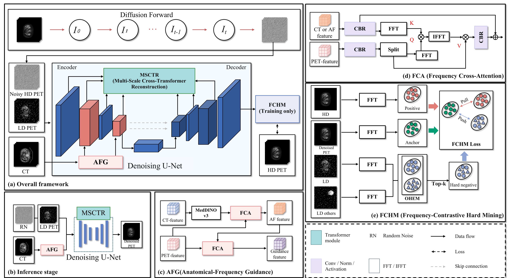

<div align="center">

# AnF-DiffPET

**Anatomy- and Frequency-Guided Diffusion for Simulated Low-Dose PET/CT Denoising**

Xuepeng Liu, Ruili Li, Zetong Liu, Renyiming Li, Yan Li, Yin Dai, Chao Li, Yueyang Teng

*Physics in Medicine & Biology*, 71(20): 205017, 2026

[[Paper]](https://doi.org/10.1088/1361-6560/aeb061) &nbsp; [English](#overview) | [中文](#中文说明)

</div>

<p align="center"></p>

## Overview

AnF-DiffPET denoises low-dose (LD) PET with a conditional diffusion model that uses the registered CT as an anatomical guide. The denoising U-Net predicts the HD PET image directly (x0-prediction). At inference, 10-step DDIM sampling starts from Gaussian noise and needs only LD PET and CT.

- **AFG (Anatomical-Frequency Guidance).** A frozen MedDINOv3 encoder extracts CT priors. Two cascaded Frequency Cross-Attention (FCA) blocks inject them into the PET features of the U-Net encoder.
- **MSCTR (Multi-Scale Cross-Transformer Reconstruction).** Channel-wise cross-transformers rebuild the skip features of all scales jointly before decoding.
- **FCHM (Frequency-Contrastive Hard Mining).** This loss is used during training only. It pulls the magnitude spectrum of the predicted HD PET towards the HD PET target and pushes it away from the *k* hardest LD PET spectra in the batch.

## Getting started

**Environment.** Python ≥ 3.8 and a CUDA GPU. Install the dependencies:

```bash
pip install -r requirements.txt
```

**MedDINOv3.** Clone [MedDINOv3](https://github.com/ricklisz/MedDINOv3) into `MedDINOv3/`. Place the ViT-B/16 CT-3M checkpoint ([Hugging Face](https://huggingface.co/ricklisz123/MedDINOv3-ViTB-16-CT-3M)) at `MedDINOv3/MedDINOv3-ViTB-16-CT-3M/model.pth`. Other locations can be set with `MEDDINOV3_REPO` and `MEDDINOV3_CKPT`.

**Data.** Put six text files in one folder: `{train,test}_{hd,ld,ct}.txt`. Each line is the path of one 2D grayscale slice. Line *i* of the HD PET, LD PET and CT lists must be the same registered slice. Slices are resized to 128 × 128.

**Train / test**

All settings live in `config.py`, including the module switches. `train.py` and `test.py` both read them, so a test always uses the architecture the model was trained with. Set a switch to `False` for the corresponding ablation:

```python
use_afg = True     # AFG: MedDINOv3 CT priors injected by two cascaded FCA blocks
use_msctr = True   # MSCTR: cross-transformer reconstruction of the skip features
use_fchm = True    # FCHM: frequency-contrastive hard mining loss (training only)
```

```bash
python train.py --data_dir data/lists
python test.py  --data_dir data/lists --checkpoint results/anf_diffpet/model-100000.pt --save_dir results/test
```

Training defaults:
- linear noise schedule;
- Adam with learning rate 2e-4, batch size 4 with 2 accumulation steps, 100k iterations, EMA 0.995;
- loss L1 + λ·FCHM with λ = 1.0 and *k* = 2.

Inference uses deterministic 10-step DDIM sampling (eta = 0), as in the paper; the step count is `sampling_steps` in `config.py`. `test.py` reports PSNR / SSIM and saves the denoised slices.

```
config.py            # module switches and hyperparameters
anfdiffpet/
├── unet.py          # CT-conditioned U-Net (AFG + MSCTR), predicts x0
├── diffusion.py     # conditional diffusion: training loss (L1 + FCHM), 10-step DDIM sampling
├── losses.py        # FCHM
├── modules/         # FCA, MedDINOv3 encoder, cross-transformer, U-Net blocks
├── trainer.py       # training loop, EMA, evaluation
└── data.py, metrics.py, visualize.py
```

## Citation

```bibtex
@article{liu2026anfdiffpet,
  title   = {AnF-DiffPET: anatomy- and frequency-guided diffusion for simulated low-dose PET/CT denoising},
  author  = {Liu, Xuepeng and Li, Ruili and Liu, Zetong and Li, Renyiming and Li, Yan and Dai, Yin and Li, Chao and Teng, Yueyang},
  journal = {Physics in Medicine \& Biology},
  volume  = {71},
  number  = {20},
  pages   = {205017},
  year    = {2026},
  doi     = {10.1088/1361-6560/aeb061}
}
```

## Acknowledgements

This code builds on several open-source projects:
- [denoising-diffusion-pytorch](https://github.com/lucidrains/denoising-diffusion-pytorch) for the diffusion process and U-Net blocks;
- [UCTransNet](https://github.com/McGregorWwww/UCTransNet) for the channel-wise cross-transformer;
- [MedDINOv3](https://github.com/ricklisz/MedDINOv3) for the CT encoder.

---

## 中文说明

AnF-DiffPET 用条件扩散模型给低剂量 PET 去噪，并用配准好的 CT 提供解剖信息。去噪 U-Net 直接预测 HD PET 图像（x0 预测）。推理时从高斯噪声出发，用 10 步 DDIM 采样，只需要 LD PET 和 CT。

- **AFG（解剖-频率引导）**：冻结的 MedDINOv3 先从 CT 中提取解剖先验，再由两级级联的频域交叉注意力（FCA）把它注入 U-Net 编码器的 PET 特征。
- **MSCTR（多尺度交叉 Transformer 重建）**：解码之前，用通道交叉 Transformer 联合重建各个尺度的跳连特征。
- **FCHM（频域对比难例挖掘）**：只在训练时使用。它在幅度谱上把预测的 HD PET 拉向真实 HD PET，同时推离同一 batch 中最难的 *k* 个 LD PET。

**使用方法**
1. 安装依赖：`pip install -r requirements.txt`。
2. 按上文 *MedDINOv3* 一段准备代码和权重。
3. 准备数据：在 `data_dir` 下放六个列表文件 `{train,test}_{hd,ld,ct}.txt`，每行是一张二维灰度切片的路径，三个列表按行一一对应。
4. 所有设置都在 `config.py` 中，train.py 和 test.py 共用。
   - 模块开关为 `use_afg`、`use_msctr`、`use_fchm`，设为 `False` 即对应的消融实验。
   - 默认设置：线性噪声调度；Adam，学习率 2e-4；损失为 L1 + FCHM，λ = 1.0，k = 2。
5. 训练和测试的命令同上。推理用 10 步 DDIM 采样（eta = 0），与论文一致。
